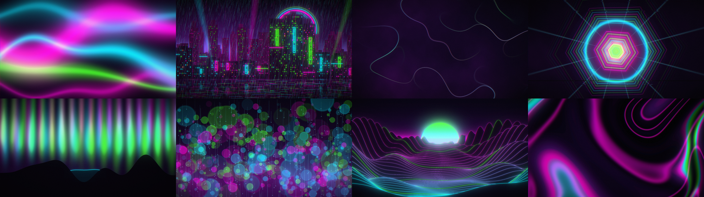

# Acid Rain

A rain-slick neon-noir [Omarchy](https://omarchy.org) theme: pure, fully
saturated **magenta**, **cyan** and **radioactive green** on ink-black violet.
Think rain-soaked megacity, holo-signage and a leaking reactor.



## What you get

- **Palette** (`colors.toml`) — terminals, bar, menus, lock screen, btop,
  Neovim, Helix, VS Code, Chromium, notifications, all from one file.
- **Triple-neon window border** — a 45° magenta → cyan → green gradient on the
  focused window, mirrored onto lock/menu/popup borders.
- **Eight procedurally generated 4K wallpapers** in `backgrounds/`, from calm
  to busy. `0-liquid-neon` is the default: soft, blurry, wavy ribbons of light
  that keep text readable. Cycle with `omarchy theme bg next`.
  0. `0-liquid-neon` — out-of-focus wavy light ribbons (default)
  1. `1-rain-district` — neon megacity in acid rain, holo-ring, wet-street mirror
  2. `2-datastorm` — flowing neon data streams on black
  3. `3-reactor-core` — nested hex rings around a radioactive core, glitch tears
  4. `4-aurora-smog` — neon aurora curtains over a dark ridgeline
  5. `5-bokeh-window` — rain-fogged window onto defocused neon city lights
  6. `6-wireframe-terrain` — vector mountains under a radioactive sun
  7. `7-plasma-ink` — marbled neon ink in black water
- **Keyboard lighting that actually matches.** See below.

## Keyboard RGB

Tools that sync a keyboard to the theme (Razer Shortcut Lights, the OpenRGB
`theme-set` hook) rank a theme's colors by chroma and take the most intense
ones. Acid Rain is built for that: magenta, cyan and green are the only
colors at full chroma, in that order (accent first), and every other color is
deliberately a notch under. Result: the board lights up in exactly the trio,
instead of drifting to a stray orange or yellow like most themes do.
`keyboard.rgb` (magenta) covers Asus ROG and Framework 16 keyboards.

## Install

```bash
omarchy theme install https://github.com/xadacka/omarchy-acid-rain-theme.git
```

or clone and run `./install.sh`.

## Regenerate the wallpapers

Needs `python3`, `numpy`, `pillow`. Output is deterministic.

```bash
python3 tools/gen_backgrounds.py backgrounds 3840 2160
```

## Uninstall

```bash
omarchy theme set tokyo-night   # or any other theme
```

## License

MIT — see `LICENSE`.
