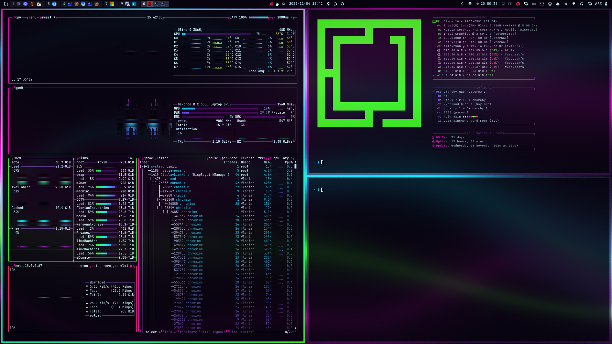

# Acid Rain

**A rain-slick neon-noir theme for [Omarchy](https://omarchy.org).**
Pure, fully saturated magenta, cyan and radioactive green on ink-black violet.
Think megacity downpour, holo-signage and a leaking reactor.




## Install

```bash
omarchy theme install https://github.com/xadacka/omarchy-acid-rain-theme.git
```

That clones the theme and applies it. To switch back to it later:

```bash
omarchy theme set acid-rain
```

## What's in it

- **Palette** (`colors.toml`): one file themes the terminal (Alacritty, Foot,
  Ghostty, Kitty), top bar, menus, notifications, lock screen, btop, Neovim,
  Helix, VS Code and Chromium.
- **Triple-neon window border**: a 45° magenta → cyan → green gradient on the
  focused window, mirrored onto lock, menu and popup borders.
- **Eight 4K wallpapers**, from calm to busy. `0-liquid-neon` is the default:
  soft, blurry, wavy light ribbons that keep text readable.

| # | Wallpaper | Vibe |
|---|-----------|------|
| 0 | `0-liquid-neon` | Out-of-focus wavy ribbons (default) |
| 1 | `1-rain-district` | Neon megacity in acid rain, holo-ring, wet-street mirror |
| 2 | `2-datastorm` | Flowing neon data streams on black |
| 3 | `3-reactor-core` | Nested hex rings around a radioactive core, glitch tears |
| 4 | `4-aurora-smog` | Neon aurora curtains over a dark ridgeline |
| 5 | `5-bokeh-window` | Rain-fogged window onto defocused city lights |
| 6 | `6-wireframe-terrain` | Vector mountains under a radioactive sun |
| 7 | `7-plasma-ink` | Marbled neon ink in black water |

```bash
omarchy theme bg next          # cycle wallpapers
omarchy theme bg-switcher      # pick from a thumbnail grid
```

## Keyboard RGB that actually matches

Most themes look dull on an RGB keyboard. Tools that sync a keyboard to your
theme (for example Razer Shortcut Lights, or an OpenRGB `theme-set` hook) rank
the colors in `colors.toml` by chroma, the gap between the strongest and
weakest channel, and light the keys with the most intense ones.

Acid Rain is built for that. Magenta, cyan and green are the only colors at
full chroma, with the accent first. Every other color is deliberately a notch
under, so the board lights up in this trio instead of drifting to a stray
orange or yellow. `keyboard.rgb` (magenta) covers Asus ROG and Framework 16
keyboards through Omarchy's built-in support.

## Palette

| Role | Hex |
|------|-----|
| Accent / magenta | `#ff00c8` |
| Cyan | `#00f0ff` |
| Green | `#39ff14` |
| Red | `#ff2a6d` |
| Blue (violet) | `#7b3bff` |
| Orange | `#ff7a3d` |
| Yellow | `#d4f53c` |
| Background | `#07030f` |
| Foreground | `#cdf8ff` |

## Customize

Don't edit the installed theme in place. Overlay it: create
`~/.config/omarchy/themes/acid-rain/` with only the files you want to change,
then re-apply:

```bash
omarchy theme set acid-rain
```

Add your own wallpapers to `~/.config/omarchy/backgrounds/acid-rain/`.

## Regenerate the wallpapers

Every wallpaper is generated from code, with fixed seeds, so the output is
reproducible. Needs `python3`, `numpy` and `pillow`.

```bash
python3 tools/gen_backgrounds.py backgrounds 3840 2160          # all eight
python3 tools/gen_backgrounds.py out 1920 1080 liquid ink       # a subset, smaller
```

Names: `liquid rain storm core aurora bokeh terrain ink`.

## Uninstall

```bash
omarchy theme set tokyo-night     # or any other installed theme
```

## License

MIT, see [`LICENSE`](LICENSE).
